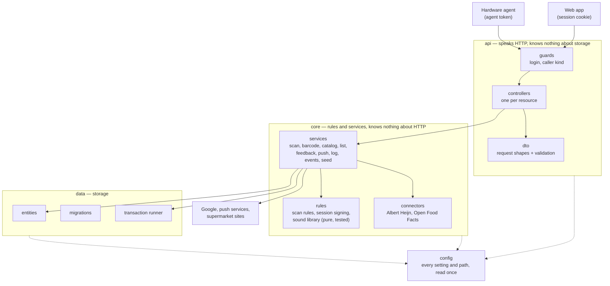

# Plan: restructure and harden the API

Status: done 2026-11-13 02:35 on branch `feature/api-restructure`, not yet released. Outcome and deviations are in the last section.

Goal: give the API the layered layout with separate `controllers` and `services` folders, and fix the weak points found in the architecture review of 2026-11-13, without changing what the product does.

## Why

The API grew from five modules to nine in two days. The review found:

| # | Finding | Weight |
|---|---|---|
| 1 | A scan is several separate database writes, without a transaction | fix |
| 2 | Settings are read from the environment in 9 files; the data folder path is derived in four places | fix |
| 3 | Every caller may do everything: the scanner agent's secret and a logged-in browser have the same rights | fix |
| 4 | The live event stream checks the login only when it opens | small |
| 5 | Three modules read or write the `barcode` table | structure |
| 6 | Module files contain controllers and request types; `catalog.module.ts` holds four controllers | structure |
| 7 | The seed file path is read in two services | structure |
| 8 | No test calls the data routes over HTTP | tests |

## Is "controllers and services folders" clean architecture?

Partly. Folders per technical role is a *layered* architecture: an outer layer that speaks HTTP, an inner layer with the rules, and a layer for storage, with dependencies pointing inward only. Clean architecture is that idea taken further: one class per use case, domain models separate from database entities, mappers between every layer, and the core depending on interfaces instead of on the database.

This plan takes the layering and the dependency rule, and leaves out the rest:

| Taken over | Left out, on purpose |
|---|---|
| Layers `api`, `core`, `data`, each with its own module | One class per use case, command and query buses |
| `controllers/`, `dto/`, `guards/` under `api`; `services/` under `core`; `entities/`, `migrations/` under `data` | Separate domain models next to the entities, and mappers between them |
| One controller per file, one entity per file, one request type per file | Repository interfaces in front of TypeORM |
| A transaction runner in `data` | |

Reason: decision 16 removed exactly those extra layers as overhead for a home tool with a handful of tables, and that has not changed. Services keep using TypeORM entities directly. If the product ever gets real domain complexity, use cases can be added inside `core` without moving anything again.

## Target layers



Dependency rule: `api` may import from `core`; `core` may import from `data`; nothing imports upward. `config` is read by all three. A lint rule enforces it, so the layout cannot erode quietly.

## Target file tree

```
apps/product-api/src/
├── main.ts
├── app.module.ts                    imports ConfigModule, DataModule, CoreModule, ApiModule
│
├── config/
│   ├── config.module.ts
│   └── app.config.ts                every environment setting and file path        (findings 2, 7)
│
├── api/
│   ├── api.module.ts                lists the controllers, registers the guard
│   ├── controllers/
│   │   ├── auth.controller.ts
│   │   ├── barcode.controller.ts
│   │   ├── catalog.controller.ts
│   │   ├── event.controller.ts
│   │   ├── feedback.controller.ts
│   │   ├── health.controller.ts
│   │   ├── icon.controller.ts
│   │   ├── list.controller.ts
│   │   ├── log.controller.ts
│   │   ├── push.controller.ts
│   │   ├── scan.controller.ts
│   │   └── section.controller.ts
│   ├── dto/
│   │   ├── barcode-mapping.dto.ts
│   │   ├── catalog-item.dto.ts      create and update
│   │   ├── list-entry-change.dto.ts
│   │   ├── log-line.dto.ts
│   │   ├── push-subscription.dto.ts
│   │   ├── scan.dto.ts
│   │   └── sound-choice.dto.ts
│   ├── guards/
│   │   ├── auth.guard.ts            session or agent token; sets who is calling    (finding 3)
│   │   ├── public.decorator.ts      route open without login
│   │   └── agent.decorator.ts       route the hardware agent may call
│   └── http.ts                      the small request and response types
│
├── core/
│   ├── core.module.ts               provides and exports the services
│   ├── services/
│   │   ├── barcode.service.ts       sole owner of the barcode table: inbox, mapping, counters   (finding 5)
│   │   ├── catalog.service.ts       sections, products, icons
│   │   ├── connector.service.ts     runs the connectors in parallel
│   │   ├── events.service.ts
│   │   ├── feedback.service.ts
│   │   ├── list.service.ts
│   │   ├── log.service.ts
│   │   ├── push.service.ts
│   │   ├── scan.service.ts          register, apply waiting scans, undo — each in one transaction  (finding 1)
│   │   ├── seed.service.ts
│   │   └── session.service.ts       cookies in and out, built on rules/session
│   ├── rules/
│   │   ├── scan-rules.ts
│   │   ├── session.ts
│   │   └── sounds.ts
│   ├── connectors/
│   │   ├── connector.model.ts
│   │   ├── ah.connector.ts
│   │   └── off.connector.ts
│   └── models.ts                    shared shapes such as ScanOutcome and FeedbackSettings
│
├── data/
│   ├── data.module.ts               TypeORM set-up, exports repositories and the runner
│   ├── database.ts
│   ├── transaction.runner.ts                                                        (finding 1)
│   ├── entities/
│   │   ├── barcode.entity.ts
│   │   ├── catalog-item.entity.ts
│   │   ├── feedback-setting.entity.ts
│   │   ├── list-entry.entity.ts
│   │   ├── push-subscription.entity.ts
│   │   ├── scan.entity.ts
│   │   ├── section.entity.ts
│   │   └── index.ts
│   └── migrations/                  unchanged, five files
│
└── test/
    ├── modules.integration.spec.ts  today's app.integration.spec.ts
    ├── auth.integration.spec.ts
    └── routes.integration.spec.ts   new: the data routes over HTTP                  (finding 8)
```

Unit tests (`*.spec.ts`) stay beside the file they test. From nine feature modules and one file per module holding several things, to four modules and one thing per file: about 30 files become about 55, with the same code.

## How the findings are handled

1. **Transactions.** A small `TransactionRunner` in `data` runs a function inside one database transaction and hands it transaction-bound repositories. `ScanService.register`, `applyPending` and `undo` each run in one. Events, push and connector lookups are sent after the transaction commits, never inside it. A test forces a failure halfway and checks nothing was written.
2. **Settings.** `AppConfig` reads every environment setting once, derives the data folder once, and offers the paths of the database, log file, push keys, session secret, seed file and icons. Services ask it. `process.env` appears in no other file; a lint rule keeps it that way. `AuthConfig` folds into it.
3. **Who is calling.** The guard recognises two callers, `user` and `agent`. Routes are for users unless marked: `@Agent()` on posting a scan, posting a log line, the event stream and reading the sound settings; `@Public()` on health and login. The agent's secret then cannot delete a product, and a scan posted by a browser is always recorded as a phone scan.
4. **Event stream.** The stream ends when its session expires or its address leaves the allowlist; the page's own reconnect logic then meets the login page. Checked once a minute.
5. **Barcode ownership.** `BarcodeService` is the only service that touches the `barcode` table. Scan, catalog and push ask it. The dependency of catalog on scan disappears: mapping a barcode is one call that links it and applies the waiting scans in the same transaction.
6. **Controllers out of module files.** Follows from the layout: a module file only lists what it wires together.
7. **Seed path.** Follows from point 2.
8. **Tests.** A third integration file starts the real API on a random port and calls the data routes: accepted and refused input per route, the agent's limits from point 3, and the scan flow end to end over HTTP.

## Steps

Each step ends with lint, both builds and all tests green, as its own commit. No step changes what the user sees. All steps are released together at the end.

| Step | What | Size |
|---|---|---|
| 0 | Record the decision: amend decisions 15 and 16 (layered layout yes; use cases, mappers, repositories still no) | small |
| 1 | Move files into `api`, `core`, `data`, `config`: split controllers, request types and entities into their own files; replace the nine modules by four. Moves only, done with `git mv` so history follows | large but mechanical |
| 2 | `AppConfig` and the lint rule against `process.env` | small |
| 3 | `BarcodeService` as sole owner of the barcode table | medium |
| 4 | `TransactionRunner`; scan actions in one transaction | medium |
| 5 | Caller kinds in the guard; event stream ends with its session | medium |
| 6 | Route tests over HTTP; lint rule for the layer boundaries | medium |
| 7 | Documentation: `architecture.md` (layout, diagram), `CLAUDE.md` (layout, rules), this plan marked done with date and time; `version` in `package.json` to `1.1.0` | small |

Order matters for 1 before the rest; 2 to 5 are independent of each other.

## Risks and how they are covered

- **Step 1 touches every import.** Covered by the compiler and the 34 existing tests; nothing is rewritten, only moved. The generated package list for the image is checked with the build cache off, after the mistake of 2026-11-13.
- **Three layer modules lose the fences between features.** Any service can then inject any other. Accepted at this size; the single-owner rule for tables (point 5) and the layer lint rule are the fences that matter.
- **Transactions on SQLite.** One writer at a time, which is already the case; the transaction makes it explicit. Long work such as connector lookups stays outside.
- **The hardware agent and step 5.** The agent only uses the four routes it keeps. Checked on the Pi after release: scanner connects, a scan arrives and beeps, sound settings load.
- **Live deploys.** Work happens on a feature branch; `master` and the Pi stay on the current version until each step is approved for release.

## Decided in review (2026-11-13)

| Question | Decision |
|---|---|
| Module cut | Four layer modules: `config`, `api`, `core`, `data` |
| Release | Everything on one feature branch, one release at the end |
| Version | The restructured API is released as `1.1.0` |
| Source of a scan | Taken from who is calling: the agent's secret means handheld, a logged-in browser means phone. The `source` field leaves the request. A notion of user types in the API may come some day; nothing is prepared for it now |

## Outcome (2026-11-13)

All eight findings are handled; lint, both builds and 51 tests pass (17 unit, 34 integration).

| Step | Commit subject | Notes |
|---|---|---|
| 1 | Move the API into api, core, data and config layers | 75 files; moves and splits only |
| 2 | Read every setting through one config class | Session secret handling became `SessionService` in core |
| 3, 4 | Give the barcode table one owner and run each scan action in one transaction | Done as one commit: the barcode service had to be transaction-aware from the start |
| 5 | Tell the hardware agent and a logged-in browser apart | Log lines from the phone got their own source |
| 6 | Test the data routes over HTTP and fence the layers with lint rules | Found and fixed: creating a product without a name answered 500 instead of 400 |
| 7 | Documentation and version 1.1.0 | A test that starts the whole app module was added as well |

Deviations from the plan as written:

- `api` may import entity *types* from `data`, because controllers return entities. The lint rules forbid the outward directions: `core` to `api`, `data` to `core` or `api`, `config` to anything.
- Request types for push are in one file (`push-subscription.dto.ts`), as planned; `core/models.ts` was not needed.
- The hardware agent still sends the `source` field. The API ignores it. It stays until the release has been out for a while, so an old API and a new agent can never disagree during an update.
- When login is off there is no token to recognise the agent by; a request that carries the agent header, even empty, then counts as the agent.

Not verified, because nothing was released: the image build in GitHub Actions, the bootstrap in `main.ts` with the real log file, and the hardware agent against the new guard on the Pi. Check after release: scanner connects, a scan arrives and beeps, sound settings load, the log shows agent lines.
