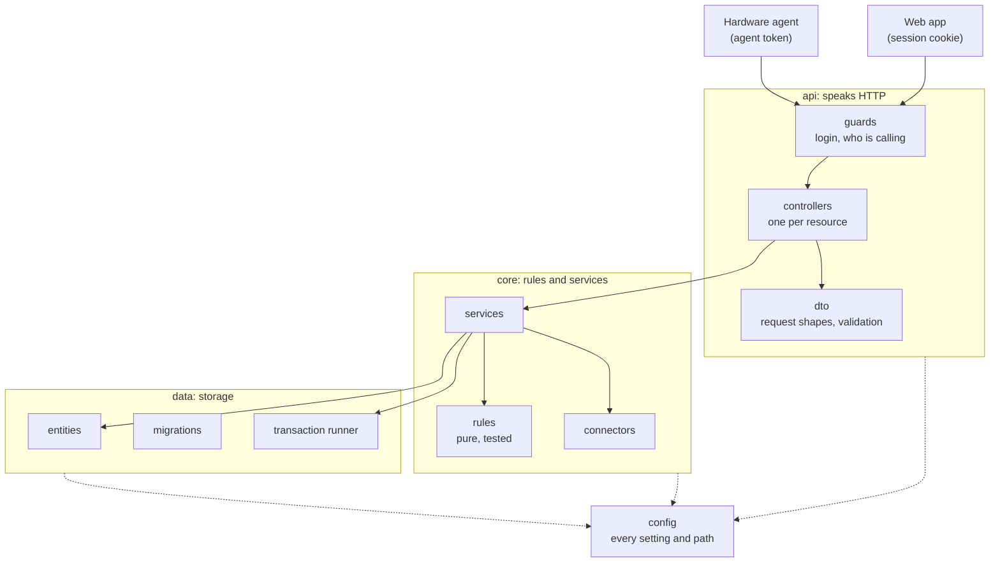

# Architecture

How the product is built today. What is still open is in [plan.md](plan.md).

```
 handheld scanner          phone / browser
        │ USB dongle              │ HTTPS
        ▼                         ▼
┌────────────────┐        ┌─────────────────────┐
│ hardware-agent │        │ Nginx Proxy Manager │  certificate
│ Python, evdev  │        └──────────┬──────────┘
└───────┬────────┘                   │
        │ POST /api/v1/scans         ▼
        │                 ┌─────────────────────────────┐      ┌───────────────────┐
        └────────────────►│ app (one container)         │─────►│ product connectors│
                          │ NestJS: API + Angular files │      │ AH, Open Food     │
                          │ SQLite on /data             │      │ Facts, ...        │
                          └──────┬───────────────┬──────┘      └───────────────────┘
                                 │               │
                                 ▼               ▼
                       push services      private backup repository
                       (Apple, Google)    (hourly SQL dump, by a host timer)
```

## Containers

| Container | Content | Notes |
|---|---|---|
| `app` | NestJS serving `/api/v1/...` and the built Angular app | SQLite at `/data/app.db` on a volume. Icons and the seed file ship inside the image at `/app/data/`. Runs migrations at start. |
| `hardware-agent` | Python, one file | Reads the scanner, posts scans and its own log lines to `app` over the compose network. Retries while the app is starting. Beeps a buzzer on a GPIO pin according to the scan result, when one is configured. |

## API layout

Layered: an outer layer that speaks HTTP, an inner layer with the rules, a layer for storage, and one place for settings. Dependencies point inward only; lint rules enforce it.



```
apps/product-api/src/
├── main.ts, app.module.ts
├── config/      app.config.ts: the only file that reads the environment
├── api/
│   ├── controllers/   auth, barcode, catalog, event, feedback, health, icon, list, log, push, scan, section
│   ├── dto/           one request shape per file, with its validation
│   ├── guards/        auth.guard, and the decorators Public, Agent, CalledBy
│   └── configure-api.ts   prefix, versioning and validation, shared by the server and the tests
├── core/
│   ├── services/      barcode, catalog, connector, events, feedback, list, log, push, scan, seed, session
│   ├── rules/         scan-rules, session, sounds: no framework, no storage
│   └── connectors/    Albert Heijn, Open Food Facts
├── data/
│   ├── entities/      one table per file
│   ├── migrations/
│   └── transaction.runner.ts
└── test/              integration tests: modules, login guard, data routes, whole app
```

| Layer | May import | Holds |
|---|---|---|
| `api` | `core`, `data` (entity types), `config` | Controllers, request types, the guard. No rules, no queries |
| `core` | `data`, `config` | Services and rules. Knows nothing about HTTP |
| `data` | `config` | Entities, migrations, the transaction runner |
| `config` | nothing | `AppConfig` |

What it deliberately does not have: a class per use case, domain models separate from the entities, mappers, repository interfaces. Services use TypeORM entities directly (decision 16).

| Service | Responsibility |
|---|---|
| `scan` | Registers a scan, names a barcode and applies its waiting scans, discards, undoes. Each of these runs in one transaction |
| `barcode` | The only service that touches the `barcode` table: inbox, links, scan counters, suggestions |
| `catalog` | Sections, products, icon names, the default icon from the seed file |
| `list` | List entries: to buy, recent, quantity, note |
| `connector` | Runs the product connectors in parallel |
| `events` | Server-sent events to open pages and the hardware agent |
| `feedback` | The library of buzzer sounds, the sound chosen per scan result, test sounds |
| `push` | Web push: subscriptions and the notification for an unknown handheld scan. Creates its key pair in `/data/push-keys.json` |
| `log` | The last 500 log lines in memory and in `/data/logs/app.log` (rotates at 256 KB, three old files), from the app, the agent and the phone |
| `agent-status` | Remembers, in memory, when the hardware agent last reported and whether it sees the scanner |
| `session` | The session secret, issuing and reading login sessions, the allowlist |
| `seed` | Fills an empty database from `data/seed-items.json` |

**Transactions.** `TransactionRunner` runs a piece of work in one database transaction and handles such pieces one at a time, since SQLite has one writer. A scan that fails halfway leaves nothing behind, and two scans at the same moment are counted in turn. Events, notifications and connector lookups go out after the commit.

**Settings.** `AppConfig` reads every environment setting once and derives the data folder and all file paths from it. No other file may read `process.env`.

The app also serves the icon files under `/icons` and the built web app for every other path. Every answer, page, icon or API, carries headers that forbid showing the site in a frame, forbid guessing content types and keep the address out of referrers to other sites. A full content security policy is not set yet (see the product review).

## Web app

Angular with standalone components and signals; no state library. `apps/product-front/src/app/`:

| Folder | Content |
|---|---|
| `pages/` | `login`, `list`, `scan` (camera), `inbox`, `catalog` (products), `item` (one product with its barcodes), `history`, `log`, `system` |
| `components/` | `shell` (navigation, offline banner, toasts), `item-tile`, `item-icon`, `sheet` (modal dialog), `item-autocomplete`, `new-item-form`, `naming-prompt`, `icon-picker`, `barcode` |
| `services/` | `auth.service` (login state, route guard), `api.service` (HTTP), `events.service` (live stream), `shopping.store` (sections, items, list and inbox as signals), `push.service`, `theme.service`, `toast.service` |

- `shopping.store` loads everything once and reloads on events from the server, so every open page follows scans made elsewhere. The shell shows a toast with undo for scans from the handheld scanner.
- Failed changes are reported in one place: an HTTP interceptor shows an error toast for every request that changes something and fails. A request that handles its own failure, such as a scan, opts out.
- Dialogs use the native `<dialog>` element, so they sit above the navigation.
- Barcodes are drawn in the browser by `BarcodeComponent`: EAN-13, EAN-8, and 12-digit codes padded to 13.
- New products get a guessed shop section from keywords in the connector suggestions and the name (`new-item-form`).
- Texts: `@ngx-translate`, Dutch by default and English, in `assets/i18n/`. Language and theme are stored in the browser.
- Theme: every colour is a CSS variable in `styles.scss`. Dark follows the device unless the user picks light or dark, which sets `data-theme` on the page.
- Addresses use the part after `#` (`/#/list`, `/#/inbox`). A notification's address then differs from the open page only after the `#`, which a browser treats as a jump inside the page instead of a new page load. An old address without `#` is rewritten at start.
- `index.html` paints the page background in the right theme and the outline of the navigation bar before the scripts run, so a cold start or reload does not flash an empty screen.
- Installable: `assets/manifest.webmanifest`, the home-screen icons and the titles in `index.html`.
- `src/sw.js` is the service worker. It handles notifications, and keeps the files of the web app so the app starts without a connection: the page itself comes from the network when there is one and from the cache otherwise; files with a version in their name come from the cache; other files come from the cache and are refreshed in the background. It never touches API calls. At every start the page asks the service worker to keep what is missing: the files the page loaded, and every script and style sheet named in `app-files.json`, a list the image build writes. So one visit is enough to open every page offline later, also pages not visited yet.
- **Without a connection** the list is shown from a snapshot of the last loaded data, kept in the browser's storage and removed at logout. The banner says from when the list is. Checking off, putting back, quantity and note also work offline: the change is shown at once, marked with a small clock on the tile, and kept in an outbox in the browser's storage with the moment it was made. When the connection returns the outbox is sent in order to `POST /api/v1/list/offline-changes`, before the list is reloaded. The server applies each change unless that list entry was changed on the server after the change was made; then the server's state stays and the page says the list was updated from the server. Scanning, naming, creating and removing products need a connection.

## Data model

| Table | Columns | Notes |
|---|---|---|
| `section` | `id`, `name`, `sort_order`, `emoji` | Seeded from `data/seed-items.json` |
| `catalog_item` | `id`, `name` (unique), `section_id`, `icon`, `emoji`, `custom` | `icon` is a file name in the icon folder, served under `/icons/<icon>.png` |
| `barcode` | `code` (key), `catalog_item_id` (nullable), `suggestions` (JSON), `lookup_failed` (JSON), `scan_count`, `last_scanned_at` | No catalog item means the barcode is in the inbox. `lookup_failed` lists the connectors that gave no answer |
| `list_entry` | `catalog_item_id` (unique), `state` (`to_buy`, `recent`), `quantity`, `note`, `updated_at` | One entry per catalog item |
| `scan` | `id`, `code`, `source` (`handheld`, `phone`), `result`, `created_at`, `undone_at`, `catalog_item_id`, `previous_state`, `previous_quantity` | History and undo; the `previous_` columns hold what the list entry was before the scan |
| `feedback_setting` | `event` (key), `sound_id` | Chosen buzzer sound per scan result; no row means the default |
| `push_subscription` | `endpoint` (key), `p256dh`, `auth`, `language`, `origin`, `created_at` | One row per device with notifications on; removed when the push service reports it gone |

On first start with an empty database, the app imports sections, items and the current list from `data/seed-items.json`.

## Scan rules

On `POST /api/v1/scans` with `{ code }`. The source is not sent: a scan posted with the agent's token is `handheld`, one posted by a logged-in browser is `phone`.

1. Same code within 1 second of the previous scan: result `ignored`. The camera page has its own, longer pause of 3 seconds for a code that stays in view.
2. Barcode has a catalog item:
   - entry is `to_buy`: quantity plus one, result `incremented`;
   - otherwise: state `to_buy`, quantity 1, result `added`.
3. Barcode has no catalog item: store the scan, query connectors if there are no suggestions yet, result `needs_name`.
4. Emit an event to open pages and return the result. For a `needs_name` scan from the handheld scanner, send a notification once the lookup is done.

When a barcode gets its mapping, its waiting `needs_name` scans are applied by rule 2.

Checking off an entry sets state `recent` and quantity 0. Undo reverses the list change of the latest scan that is not undone.

## Connectors

```ts
interface ProductConnector {
    readonly id: string;
    lookup(code: string): Promise<ProductSuggestion | undefined>;
}

interface ProductSuggestion {
    connectorId: string;
    title: string;
    brand?: string;
    category?: string;
    imageUrl?: string;
}
```

- All enabled connectors run in parallel with a timeout of a few seconds. A failure or timeout yields no suggestion, is logged, and is remembered on the barcode, so the naming prompt can say which source gave no answer and offer to ask again. "No result" and "no answer" are different things.
- The lookup runs in the background after the scan is answered, so a slow connector never delays the scanner. Results are stored on the barcode row, so a barcode is looked up once, and a `barcode` event tells open pages they arrived.
- `CONNECTORS` in `.env` picks the enabled ones (default `ah,off`).
- `category` and `title` feed the section guess in the naming prompt.
- Built: Albert Heijn (unofficial API, anonymous token) and Open Food Facts (official open API, with a generic User-Agent). Adding a source is one new class, plus its logo in `apps/product-front/src/assets/connectors/` and a line in the naming prompt's connector table; without a logo the prompt shows the connector's id as text.

## API

| Method and path | Purpose |
|---|---|
| `POST /api/v1/scans` | Register a scan; open to the agent |
| `POST /api/v1/scans/undo` | Undo the latest scan |
| `GET /api/v1/scans` | History |
| `GET /api/v1/list` | List entries with their catalog items |
| `PATCH /api/v1/list/:itemId` | State, quantity, note |
| `POST /api/v1/list/offline-changes` | Changes made without a connection, each with its time; answers how many were applied and which entries the server kept |
| `DELETE /api/v1/list/:itemId` | Delete the entry; the web app uses it to remove a product from recent |
| `GET /api/v1/catalog`, `POST`, `PATCH /:id`, `DELETE /:id` | Catalog items |
| `GET /api/v1/catalog/:id` | One catalog item with its barcodes (number, suggestions, scan count, last scan) and `defaultIcon`, the icon the seed file gives a product of that name |
| `GET /api/v1/sections` | Shop sections in display order |
| `GET /api/v1/barcodes?unmapped=true` | Inbox |
| `GET /api/v1/barcodes/:code` | One barcode with its suggestions |
| `PUT /api/v1/barcodes/:code` | Set or change the mapping |
| `DELETE /api/v1/barcodes/:code` | Remove the mapping |
| `GET /api/v1/events` | Server-sent events: `scan`, `list`, `barcode`, `catalog`, `log`, `feedback`, `feedback_settings`, and a `ping` every 25 seconds |
| `GET /icons/<icon>.png` | Icon files |
| `GET /api/v1/icons` | Names of the available icons, for the icon picker |
| `POST /api/v1/barcodes/:code/lookup` | Ask the connectors again; keeps what was found before |
| `POST /api/v1/barcodes/:code/discard` | Cancel the waiting scans of an unnamed barcode and drop it from the inbox |
| `GET /api/v1/feedback/settings` | The sound chosen per event, and the library of sounds |
| `PUT /api/v1/feedback/settings/:event` | Choose the sound for an event, or `none` |
| `POST /api/v1/feedback/test` | Play one sound from the library at the scanner |
| `GET /api/v1/logs`, `POST` | The latest log lines; the hardware agent and the phone post their own |
| `GET /api/v1/push/key` | Public key a browser needs to subscribe to notifications |
| `POST /api/v1/push/subscriptions`, `DELETE` | Store or remove this device's subscription |
| `POST /api/v1/push/test` | Send a test notification to every subscribed device |
| `GET /api/v1/agent/status`, `POST` | Whether the hardware agent is there and sees the scanner, and the time of the last handheld scan; the agent posts its state when it changes and once a minute |
| `GET /api/v1/auth/me` | Whether login is on, and who is logged in |
| `GET /api/v1/auth/google`, `GET /api/v1/auth/google/callback` | Start and finish of the Google login |
| `POST /api/v1/auth/logout` | End the session |
| `GET /api/v1/health` | Status, version, commit and build time; also Docker's health check |

## Login

Optional, switched on by setting `GOOGLE_CLIENT_ID`. Without it the API is open to whoever can reach it and the reverse proxy is the only guard.

- **Flow**: the login page links to `GET /api/v1/auth/google`, which sends the browser to Google with a random state kept in a short-lived cookie. Google returns to `/api/v1/auth/google/callback`; the API checks the state, exchanges the code with Google using the client secret, and reads the account from the answer. The account must have a verified address that is listed in `ALLOWED_EMAILS`.
- **Session**: a cookie holding the address and an expiry, signed with a secret the app creates in `/data/session-secret`. No session table. It lasts 90 days and is renewed when the app is opened after a day or more. `HttpOnly`, `Secure`, `SameSite=Lax`. Removing an address from `ALLOWED_EMAILS` ends its sessions at once.
- **Guard**: one global guard covers every API route and the event stream. Open without login: the health check and the `auth` routes. The files of the web app and the icons are public; they hold no data.
- **Hardware agent**: has no Google account. It sends the `AGENT_TOKEN` from `.env` in the `X-Agent-Token` header. The guard records who is calling, `user` or `agent`, and the token only opens the routes marked `@Agent()`: posting a scan, posting a log line, the event stream and reading the sound settings. Anything else answers 403 to the agent.
- **Other sites**: a request that changes something and names another site as its origin is refused.
- **Event stream**: a browser's stream is checked once a minute and ends when its session has expired or its account left the allowlist.
- **Web app**: a route guard asks `GET /api/v1/auth/me` once; without a session it shows the login page. Any "not logged in" answer later sends the user there too. The System page shows the account and a logout button.
- No passwords, no user table, no roles: everyone on the allowlist shares the one list.

## Staying connected

The page listens to `/api/v1/events`. When that stream ends for good, which happens when the app restarts during an update or the proxy answers with an error page, the page opens a new one every 3 seconds until it works. It also reconnects when the browser reports the network is back, and when the page returns to the foreground after 40 seconds without a ping. After every reconnect and every return to the foreground it reloads its data, and a failed load is retried every 5 seconds. The "no connection" banner is shown in between.

## Notifications

Web push, so it works with the app closed. The frontend registers a small service worker (`/sw.js`, no caching) that shows the notification, sets the number on the app icon, and opens the inbox when tapped. A tap stores the page to open in a small cache entry and wakes the app; the app reads the entry when it gets the message, when it returns to the foreground, when it starts, and every 1.5 seconds while it is visible. A message alone is not enough: on the iPhone it did not arrive, with the app in the background or in front. Each tap also writes a line to the system log.

- Message format: declarative web push (`"web_push": 8030` with a `notification` that carries title, body, badge and the address to open). A browser that knows the format, Safari from iOS 18.4, shows the notification and opens the address itself, without the service worker; that is what makes a tap open the inbox on the iPhone, where the service worker's own tap handling did not. Other browsers hand the same message to the service worker, which shows it and handles the tap. The address needs the site's own origin, which each device sends along when it subscribes.
- Sent when: a scan from the handheld scanner ends in `needs_name`. Scans from the phone camera do not notify; the phone is already showing the naming prompt. The notification goes out after the connector lookup, so it can name the product the supermarket knows for that barcode.
- Content: title, the suggested product name with the barcode, and the number of barcodes in the inbox as badge. Texts are Dutch or English, following the language the device had when it subscribed.
- The badge is also set by the open app whenever the inbox changes. With the app closed it only changes when a notification arrives, because every push must show a notification.
- iPhone: only for the site installed on the home screen (iOS 16.4 or later), and permission must be asked from a tap, which the System page does.
- The server only makes outgoing calls to the push service of the browser maker (Apple, Google, Mozilla). A failure is logged and never fails a scan.

## Phone camera

- Needs HTTPS, which the proxy provides.
- Decoding is done in JavaScript by `@zxing/browser`, because Safari on iOS offers no `BarcodeDetector`. Confirmed working on the iPhone and on a laptop.
- The frame on screen is only a guide; the decoder reads the whole picture.
- The camera stops while the naming prompt is open and restarts after.
- Formats: EAN-13, EAN-8, UPC-A. A code can also be typed.

## Feedback at the scanner

The hardware agent turns the result of each scan into a sound on a buzzer connected to a GPIO pin of the Pi. Which sound belongs to which result is chosen on the System page.

| Event | Default sound |
|---|---|
| `added` | short beep |
| `incremented` | two blips |
| `needs_name` | long beep |
| `held`: the app is not reachable; the scan is kept and delivered later | long, short |
| `error`: scan rejected, or too many scans waiting | three beeps |
| `ignored`: repeat within the debounce | none |

- **Sounds** are lists of steps: `on` and `off` with a length, and `gate`, which switches the buzzer on and off many times a second. An active buzzer has one fixed pitch, so gating is what gives it other sounds: a trill at 5 to 30 times a second, a rough buzz at a few hundred, a softer tone with a short on-time. The library of sounds is `apps/product-api/src/feedback/sounds.ts`; a new sound is one line there plus its name in both language files.
- **Settings**: the `feedback_setting` table holds the chosen sound per event; an event without a row uses the default, and `none` means silent. The System page shows a dropdown per event and a button per sound to listen to it.
- **Agent**: fetches the settings, with the steps of each chosen sound, when it connects to the event stream and again on a `feedback_settings` event, and keeps them in memory. So a scan that cannot reach the API still gets its error sound. Before the first contact it uses the built-in defaults.
- **Test**: `POST /api/v1/feedback/test` sends a sound as a `feedback` event, which the agent plays at once.
- `FEEDBACK_OUTPUT` picks the output: `none` (default) or `buzzer`. Another output, such as a speaker, would be another class next to `Buzzer`. A passive buzzer gets a square wave made in software.
- The pin is driven through the kernel's GPIO character device (`/dev/gpiochip0`) with `libgpiod`; the container gets that one device and stays unprivileged.
- **Held scans.** When the app cannot be reached, which happens for some seconds at every update, the agent keeps the scan with the moment it was made, plays the "held" sound and tries again every two seconds. Scans are delivered in the order they were made, each with its own time, so two cartons of the same product scanned ten seconds apart still count as two. The API takes that time from the agent only, and not when it is older than an hour. Held scans live in memory: at most 50, for at most 30 minutes, and a restart of the agent loses them.
- Sounds play on their own thread, so a beep never delays reading the next scan. A buzzer that cannot be opened is logged once and the agent carries on without sound.
- `python3 agent.py --test-feedback` plays the sound of every event once.
- `test_agent.py` tests the agent without hardware: key events become scans, sound steps drive a fake GPIO line, settings and scans go to a fake API.

## Backup

Outside the containers: a timer on the Pi dumps the database as SQL and pushes it to a private repository. See [deployment.md](deployment.md).
